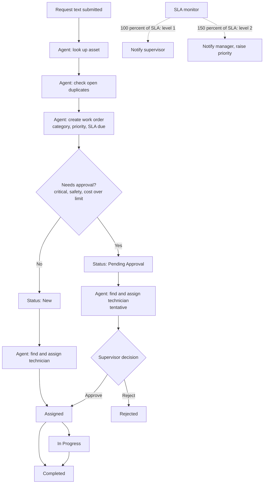

# Functional Requirements Document

Every functional requirement (FR) links to a business requirement (BR) in `BRD.md` and to test cases in `test_cases.md`.

## 1. Workflow

## 2. Functional requirements
| ID | Requirement | BR | Tests |
|---|---|---|---|
| FR-01 | `POST /api/requests` accepts `text` (1 to 1000 chars) and optional `requester`, `location`; returns the work order and a full tool-call trace | BR-01 | TC-01, TC-18 |
| FR-02 | The agent classifies into one configured category and one configured priority; unknown values are rejected by the tool layer | BR-02 | TC-02, TC-20 |
| FR-03 | Location is normalised (for example "Block C, Room 204") and used for asset lookup; an asset in a different room is never linked | BR-03 | TC-03, TC-04 |
| FR-04 | Open work orders with the same category and overlapping location are reported as duplicates; the new order stores `repeat_of` | BR-04 | TC-09 |
| FR-05 | Technician candidates must be available and match the category's skill, ordered by open workload; mismatched skills cannot be assigned | BR-05 | TC-08, TC-10 |
| FR-06 | With no available technician the order is created unassigned and the response says so | BR-05 | TC-11 |
| FR-07 | Approval is required when priority is in `approval.priorities`, category is in `approval.categories`, or estimated cost exceeds `approval.cost_above` | BR-06 | TC-05, TC-07 |
| FR-08 | A pending order keeps its tentative technician; `POST /api/work-orders/{id}/decision` with `approve` dispatches it and `reject` closes it; decisions on non-pending orders are refused | BR-06 | TC-05, TC-06 |
| FR-09 | `due_at = created_at + sla_hours(priority)` | BR-02 | TC-12 |
| FR-10 | SLA monitor: at `level1_after_sla_pct` notify the supervisor; at `level2_after_sla_pct` notify the manager and raise priority one step; each level fires once; closed orders are ignored | BR-07 | TC-12, TC-13, TC-14 |
| FR-11 | Status flow: Assigned to In Progress to Completed (or Assigned to Completed); other jumps return 400 | BR-02 | TC-15 |
| FR-12 | Every create, assign, decision, status change and escalation writes an event with actor, action, detail and time | BR-08 | TC-16 |
| FR-13 | `GET /api/dashboard` returns totals (open, overdue, pending approval, escalated, completed), breakdowns, SLA compliance, average resolution time, top problem assets and repeat issues | BR-09 | TC-17 |
| FR-14 | `GET /api/summary/daily` returns a plain-language summary | BR-09 | TC-17 |
| FR-15 | All rules in section 3 are read from `config.json` | BR-10 | TC-07, TC-12 |
| FR-16 | If the Claude call fails or no key is set, the rule-based agent handles the request through the same tools | BR-11 | TC-20 |

## 3. Configuration (`config.json`)
| Key | Meaning |
|---|---|
| `categories.<name>.skill` | Technician skill required |
| `categories.<name>.keywords`, `weight` | Used by the rule-based classifier |
| `categories.<name>.default_cost` | Cost used when none is estimated |
| `priorities.<name>.sla_hours` | SLA per priority |
| `priority_keywords` | Urgency wording for the rule-based agent |
| `approval` | Priorities, categories and cost limit that need approval |
| `escalation` | SLA percentages and who is notified at each level |

A new site type or category needs only a config change plus matching technicians and assets.

## 4. Data model
`assets`, `technicians`, `work_orders`, `events` (audit trail), `notifications`. See `app/models.py`.

## 5. Agent tools
| Tool | Purpose |
|---|---|
| `lookup_asset` | Find registered assets for a location and category |
| `check_duplicates` | Find open orders for the same place and category |
| `create_work_order` | Create the order (validates category, priority, asset) |
| `find_technician` | Available, skilled technicians ranked by workload |
| `assign_technician` | Assign (validates skill and status) |

The agent has no approve, delete or status tools, by design.

## 6. Non-functional requirements
- Works without the AI service (FR-16).
- SQLite by default; MySQL by changing `DATABASE_URL`.
- Dashboard renders all data as text, never as HTML, so request text cannot inject markup.
- The rule-based agent responds in milliseconds; the Claude path adds model latency.
